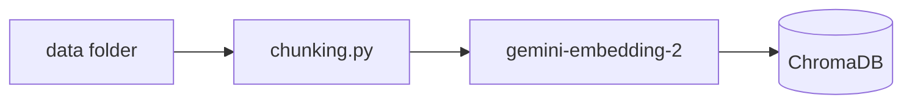
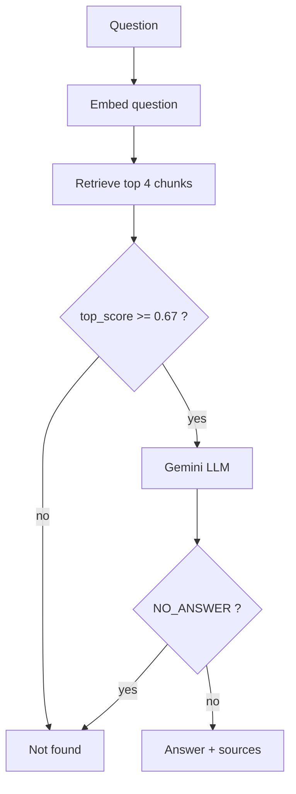

# NovaDesk Lite 🛠️

בוט תמיכה טכנית לעובדי החברה הבדיונית **נובה טק**. הבוט עונה על שאלות IT **רק מתוך המידע הפנימי של החברה**: מדריכים של צוות IT, מילון מונחים פנימי וטיקטים שכבר נפתרו. לכל תשובה מצורפים המקורות שלה, וכשאין מידע מתאים במאגר הבוט אומר "לא מצאתי" במקום להמציא.

**למה צריך את זה?** צ'אטבוט ציבורי לא יודע מה זה NovaConnect, באיזו קומה נמצאת HP-3F, או איך טכנאי של החברה פתר בעיה של דפים לבנים במדפסת. הבוט הזה יודע, כי הוא בנוי על הידע של הארגון עצמו (RAG).

---

## 💬 דוגמאות

| שאלה | מה הבוט עושה | למה |
|---|---|---|
| יוצאים דפים לבנים מהמדפסת בקומה 3 | ✅ עונה, מקור: טיקט 1043 | יש טיקט פתור בדיוק על זה |
| אני בבית קפה וה-VPN לא מתחבר | ✅ עונה, מקור: מדריך NovaConnect | המדריך מכסה התחברות מבחוץ |
| מה זה בקשה ירוקה? | ✅ עונה, מקור: המילון | מונח פנימי של החברה |
| איך עובדים מהבית? | ✅ עונה משני מדריכים | משלב את מדריך קליטת העובד ואת מדריך ה-VPN |
| המדפסת בבית שלי לא מדפיסה | ❌ לא מצאתי | המדריכים מדברים רק על מדפסות המשרד |
| מתכון לעוגת שוקולד | ❌ לא מצאתי | לא קשור ל-IT בכלל |

---

## ⚙️ איך זה עובד

הפרויקט בנוי משני מסלולים.

### 1. טעינת הידע (רץ פעם אחת)



1. **קבצי המקור** (`data/`): 12 מדריכים, מילון של 22 מונחים, 29 טיקטים פתורים ו-4 משתמשים.
2. **חיתוך לקטעים** (`chunking.py`):
   - מדריך: קטע אחד לכל כותרת `##`
   - מילון: קטע אחד לכל מונח
   - טיקט: קטע אחד שלם, כדי שהבעיה והפתרון יישארו יחד
   - לכל קטע יש כותרת הקשר בעברית ומזהה קבוע, למשל `guide-01-vpn-from-home-3` או `ticket-1043`
3. **הפיכה לוקטורים** (`models.py`): כל קטע נשלח ל-Gemini embeddings בקבוצות של 10, עם ניסיון חוזר כשהשירות עמוס.
4. **שמירה** (`store.py`): ChromaDB שנשמר בדיסק, עם מרחק cosine.

### 2. מסלול השאלה (רץ על כל שאלה)



1. השאלה הופכת לוקטור.
2. נשלפים 4 הקטעים הכי דומים מ-ChromaDB.
3. **שער 1, הסף:** אם הקטע הכי קרוב קיבל ציון נמוך מ-0.67, הבוט עונה "לא מצאתי" **בלי לפנות ל-LLM בכלל**.
4. הקטעים והשאלה נשלחים ל-Gemini, עם הוראות לענות רק מתוך הקטעים.
5. **שער 2, השופט:** אם ה-LLM מזהה שהקטעים רק נוגעים בנושא דומה ולא באמת עונים, הוא מחזיר `NO_ANSWER`, והבוט עונה "לא מצאתי".
6. אחרת, מוצגת התשובה עם המקורות שלה.

---

## 🧰 טכנולוגיות

| חלק | טכנולוגיה | תפקיד |
|---|---|---|
| שפה | Python | |
| RAG | LlamaIndex | חיבור בין החיתוך, המאגר והמודלים |
| מאגר וקטורים | ChromaDB | שמירת הקטעים והוקטורים בדיסק |
| מודל שפה | Gemini (`gemini-3.5-flash-lite`) | ניסוח התשובה ושיפוט הרלוונטיות |
| Embeddings | Gemini (`gemini-embedding-2`) | הפיכת טקסט לוקטור |
| ממשק | Streamlit | צ'אט בעברית, מימין לשמאל |
| מודלי נתונים | Pydantic | `Source`, `AnswerResult` |
| הגדרות | python-dotenv | קריאת `.env` |

---

## 📁 מבנה הפרויקט

```
├── app/
│   ├── config.py          # ההגדרות מ-.env
│   ├── ingest.py          # טעינת הידע ל-ChromaDB
│   └── rag/
│       ├── models.py      # חיבור ל-Gemini (LLM ו-embeddings)
│       ├── chunking.py    # חיתוך המדריכים, המילון והטיקטים
│       ├── store.py       # ChromaDB: שמירה ושליפה
│       ├── prompts.py     # ההוראות ל-LLM
│       └── pipeline.py    # answer_question: כל מסלול השאלה
├── data/
│   ├── guides/            # 12 מדריכים
│   ├── glossary.md        # מילון מונחים
│   ├── seed_tickets.json  # טיקטים פתורים
│   ├── seed_users.json    # משתמשים וטכנאים
│   └── test_questions.json
├── tools/
│   └── threshold_experiment.py  # הניסוי לקביעת הסף
├── chat_ui.py             # ממשק Streamlit
└── .env.example
```

---

## 🚀 הרצה

**דרישות:** Python 3.11 ומעלה, ומפתח API של Google AI Studio.

```powershell
# 1. סביבה וירטואלית
python -m venv .venv
.venv\Scripts\Activate.ps1
pip install -r requirements.txt

# 2. הגדרות: להעתיק ולהכניס את המפתח ל-GOOGLE_API_KEY
copy .env.example .env

# 3. טעינת הידע ל-ChromaDB (פעם אחת, או אחרי שינוי ב-data)
python -m app.ingest

# 4. הפעלת הצ'אט
streamlit run chat_ui.py
```

### הגדרות ב-`.env`

| משתנה | ערך | מה הוא קובע |
|---|---|---|
| `GOOGLE_API_KEY` | | המפתח ל-Gemini (לא עולה ל-Git) |
| `LLM_MODEL` | `gemini-3.5-flash-lite` | מודל השפה |
| `EMBED_MODEL` | `gemini-embedding-2` | מודל ה-embeddings |
| `SIMILARITY_THRESHOLD` | `0.67` | הסף של שער 1 |
| `TOP_K` | `4` | כמה קטעים נשלפים לכל שאלה |
| `EMBED_BATCH_SIZE` | `10` | כמה קטעים נשלחים יחד בטעינה |
| `EMBED_MAX_RETRIES` | `6` | כמה פעמים לנסות שוב כש-Gemini עמוס |

---

## 🧠 החלטות מעניינות

**קידומות ל-embeddings.** המודל `gemini-embedding-2` לא מבחין לבד בין שאלה למסמך, אז מוסיפים קידומת: `task: search result | query:` לשאלות, ו-`title: none | text:` לקטעים. בלי הקידומות, סעיף "נייר נתקע" במדריך המדפסות דורג מעל טיקט 1043, שהוא בדיוק התשובה לדפים לבנים.

**חיתוך לפי סעיפים.** כל `##` הוא קטע אחד, וכל טיקט הוא קטע שלם, כדי שהבעיה והפתרון לא ייחתכו באמצע.

**מדריך גובר על טיקט.** כשיש סתירה, ה-LLM מקבל הוראה להעדיף את המדריך הרשמי, ומבין שני טיקטים, את החדש יותר.

**הגנה מעקיפת ההוראות.** ההוראות ל-LLM נשלחות כ-system prompt, והשאלה עטופה בתגיות, כך שעובד לא יכול לכתוב "תתעלם מההוראות". רוב הניסיונות האלה נעצרים כבר בשער 1, כי הם לא דומים לשום דבר במאגר.

**למה התשובות מנוסחות קצת אחרת בכל פעם?** מודלי Gemini 3 עובדים עם temperature 1.0, וגוגל ממליצים לא להוריד אותו. השליפה, הציונים והמקורות קבועים, ורק הניסוח משתנה.

---

## 🚧 מגבלות

- כל שאלה עומדת בפני עצמה. הבוט לא זוכר את ההודעות הקודמות בשיחה.
- המאגר נבנה מחדש מאפס בכל טעינה, ואין עדכון הדרגתי.
- הנתונים בדיוניים, ונכתבו במיוחד לפרויקט.

---

**לאה שטול** · פרויקט קורס, שנה ב'
